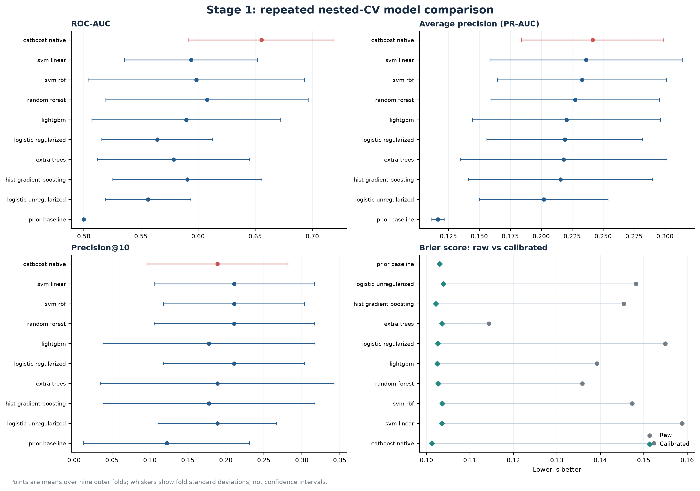
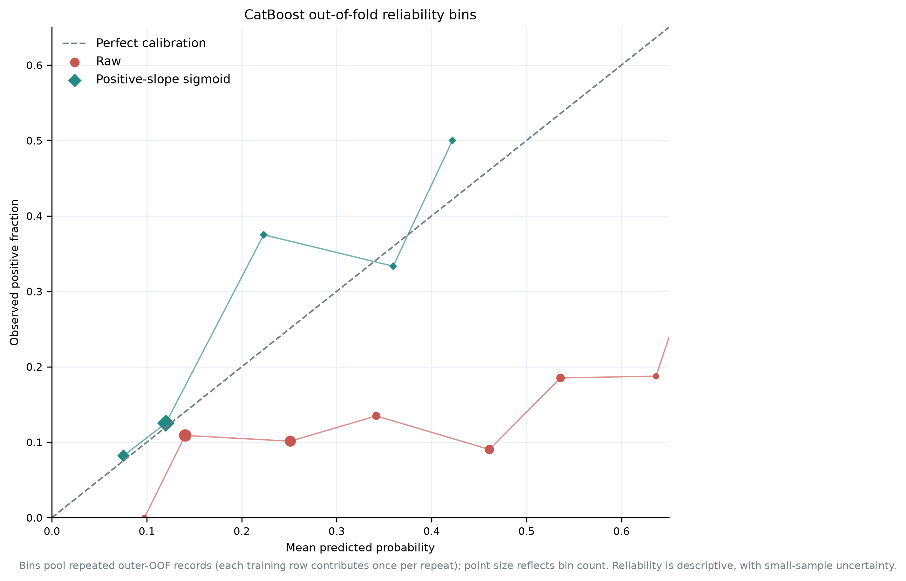
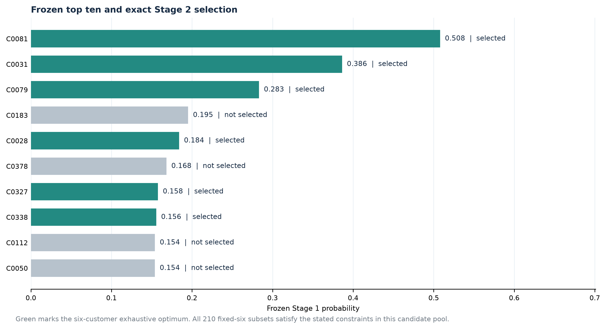
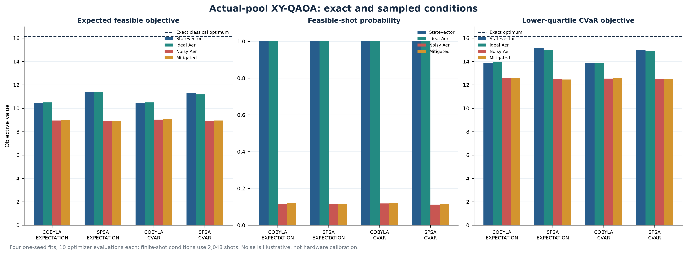
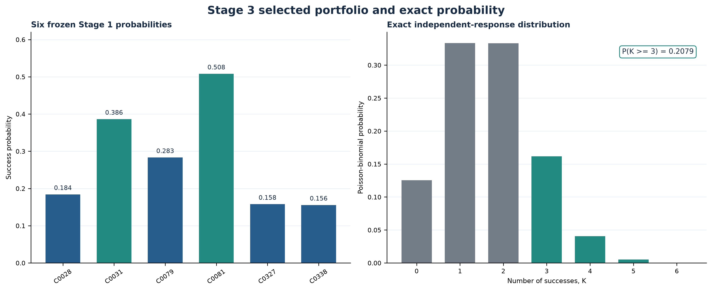
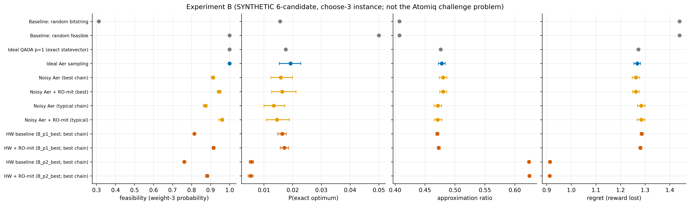

# ATOMIQ · Hybrid Quantum–Classical Campaign Optimization

**A three-stage, leakage-controlled study:** predict customer response from training data, select an exact six-customer portfolio, and estimate the probability of at least three subscriptions. This repository separates exact classical answers, quantum simulation, synthetic diagnostics, and actual IBM hardware results.

> **Scientific scope.** Two IBM jobs completed: a Stage 3 probability circuit on ibm_marrakesh, and a p=1/p=2 QAOA comparison on a separate synthetic problem on ibm_kingston. The hardware QAOA experiment is not the customer-selection task. The work shows circuit execution and measured results; it does not establish quantum advantage.

## Final result

| Stage | Validated result |
|---|---|
| **1 · Predict** | CatBoost mean outer-fold PR-AUC **0.2417** (SD 0.0574); ROC-AUC **0.6555** (SD 0.0636). Training-only estimates on 300 rows / 35 positives, not held-out test metrics. |
| **2 · Select** | **C0028, C0031, C0079, C0081, C0327, C0338**. Exact objective **16.1710314161**; exhaustive enumeration and independent MILP agree. |
| **3 · Estimate** | Exact independent-response probability **P(K ≥ 3) = 0.2078515973394121**. Dynamic programming and enumeration of all 64 outcomes agree. |
| **IBM hardware** | Stage 3 raw estimate **0.201538** (8,192 shots; 95% Wilson interval 0.192992–0.210364). QAOA p=1 and p=2 used 30,000 shots per depth. Total recorded QPU usage: **31 seconds**. |

## The pipeline

### 1. Response prediction

Ten classical candidates were compared with repeated stratified nested cross-validation. Preprocessing, tuning, and positive-slope sigmoid calibration were fit inside each training fold. Customer IDs and duration were excluded as predictors; Stage1_Test labels were not loaded or used.

<em>Model means and fold variation. Error bars show fold standard deviation, not confidence intervals.</em>

<em>Calibration improved validation Brier score and log loss; small-sample and distribution-shift uncertainty remains.</em>

### 2. Exact customer selection

The frozen top ten define 210 possible six-customer portfolios. Enumeration and an independently encoded SciPy MILP selected the same six. All 210 portfolios happen to satisfy the supplied budget and capacity limits, so those constraints are nonbinding for this shortlist.

<em>Stage 1 probabilities rank the shortlist; the operational objective determines the final six.</em>

A real Qiskit exact-six circuit was also exercised on this actual shortlist in local simulation. Its small optimizer budgets were not convergence-certified, and its outcomes did not replace the exact classical oracle.

<em>Actual-candidate-pool QAOA simulation. These are local statevector/Aer results, not IBM hardware measurements.</em>

### 3. Probability of at least three subscriptions

Under the challenge independence assumption, the six frozen probabilities give an exact Poisson-binomial tail probability of **0.2078515973394121**. The six-qubit statevector reproduces it. Finite-shot simulation and readout mitigation are compared in the report; mitigation did not consistently improve error.

<em>Exact distribution of K, the number of subscriptions; the target event sums probabilities for K ≥ 3.</em>

### IBM hardware evidence

The Stage 3 IBM run measured the actual six-customer probability circuit on Marrakesh. Its readout-mitigated estimate was 0.202275; the estimated mitigation effect was inconclusive. The QAOA hardware run used a separate synthetic choose-three instance: p=2 had a higher approximation ratio but sampled the exact optimum less often than p=1. Mitigation raised measured feasibility, while approximation-ratio changes were small with overlapping intervals.

<em>IBM and simulation quality metrics for the synthetic QAOA task, not the bank-customer selection.</em>

**Provenance note:** the supplied Colab export mislabeled the resumed Stage 3 job with the currently selected Kingston backend and layout. Canonical records correct it to ibm_marrakesh on [87, 6, 10, 139, 120, 107]. The immutable supplied export is preserved alongside the correction. See the [hardware audit](reports/ibm_hardware_execution_audit.md).

## Start here

- [Final research report (PDF)](output/pdf/atomiq_final_research_report.pdf)
- [Final challenge results and methods](reports/final_actual_challenge_results.md)
- [IBM execution and provenance audit](reports/ibm_hardware_execution_audit.md)
- [Run and environment instructions](docs/reproducibility.md)
- [Documentation index](docs/README.md)
- [Reports and evidence index](reports/README.md)
- [Machine-readable results index](results/README.md)
- [Research project state and experiment history](PROJECT_STATE.md)

## Reproduce

Validated local environment: Windows x86-64, CPython 3.12.14, Qiskit 2.6.2, Qiskit Aer 0.18.2. From PowerShell at the repository root:

<pre>
py -3.12 -m venv .venv
.venv\Scripts\python.exe -m pip install -r requirements-lock.txt
.venv\Scripts\python.exe -m pip check
.venv\Scripts\python.exe -m pytest -q
</pre>

The final local test run passed **61 tests**. See the [reproducibility guide](docs/reproducibility.md) for experiment commands and [results guide](results/README.md) for authoritative outputs. The notebook is [available here](notebooks/atomiq_ibm_hardware_experiments_QAOA_HARDWARE_EXPANDED.ipynb); hardware submission is disarmed by default.

## Data access and limits

The original challenge PDF and participant workbook are deliberately absent from this public repository because redistribution permission has not been established. Obtain them through the authorized competition channel and place them under data/raw/ for data-dependent reproduction. The code and saved results do not include test labels or label-derived aggregate totals.

Stage 1 is based on only 300 labeled rows and 35 positive cases. Stage 2 is exact only for its frozen shortlist and supplied probabilities. The final shortlist does not test binding resource constraints. The challenge QAOA fit was budget-limited; the hardware QAOA problem is synthetic. Stage 3 assumes independent outcomes. These results do not demonstrate quantum advantage.
