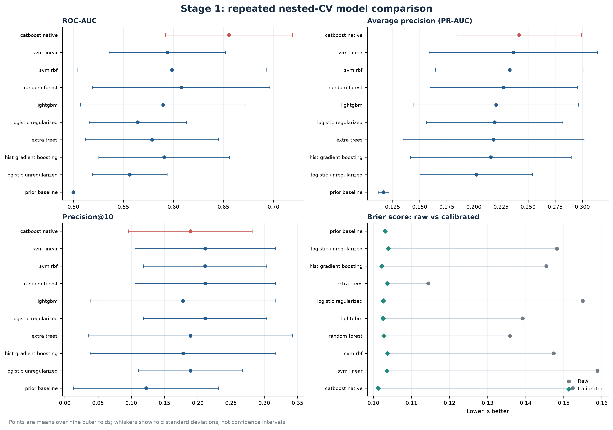
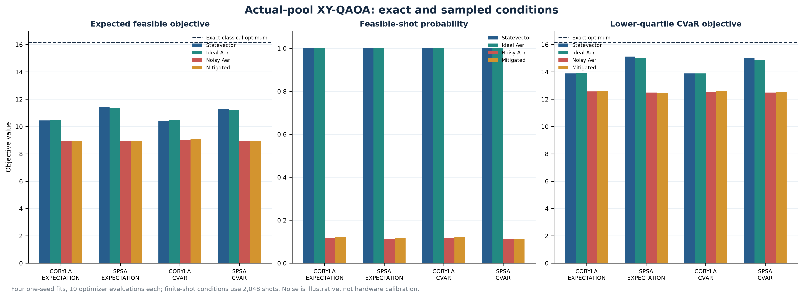
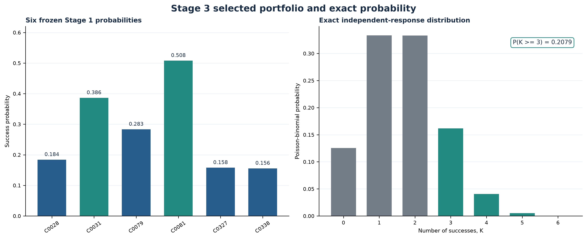
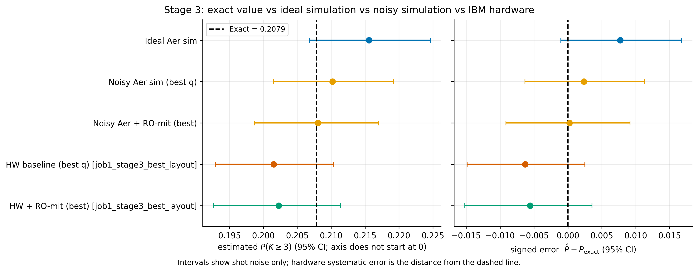
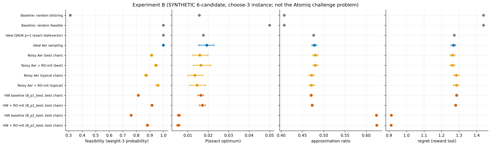

# ATOMIQ Project Results: Teammate Handoff Guide

**Prepared:** 12 November 2026  
**Repository:** [Athleity/Atomiq-Hybrid-Quantum-Optimization](https://github.com/Athleity/Atomiq-Hybrid-Quantum-Optimization)  
**Purpose:** explain what was actually measured, how to interpret each result family, which evidence is authoritative, and where each artifact lives in the repository.

> **Use this guide as the map, not as a replacement for the machine-readable files.** Exact parameters, per-fold/per-shot records, raw counts, seeds, intervals, and audit fields are in the linked CSV/JSON artifacts. Every number below is rounded for readability unless stated otherwise.

## 1. Results at a glance

| Stage / experiment | Main result | What it establishes | What it does not establish |
|---|---|---|---|
| Stage 1 classical model selection | CatBoost leads the original repeated-CV tournament: mean average precision 0.242 (fold SD 0.057), ROC-AUC 0.656 (0.064), Precision@10 0.189. | A reproducible training-only model-selection result across nine outer folds. | It is not test-set accuracy, and the lead over linear SVM (AP 0.236) is small relative to fold variation. |
| Stage 1 probability calibration | For CatBoost, mean Brier 0.152 to 0.101, log loss 0.477 to 0.353, and ECE 0.183 to 0.018 after positive-slope sigmoid calibration. | Calibration improved these aggregate reliability scores while preserving the selected model's ranking/top ten. | It does not make individual probabilities certain; validation folds have few positives and calibration diagnostics remain unstable for some models. |
| Frozen Stage 1 inference | 100 feature-only scores were written after model freeze; customer ID is an output key, not a predictor. | A reproducible score artifact for downstream shortlist construction. | No test-label score or test-set metric exists in this project. |
| Stage 2 exact selection | Enumeration and SciPy MILP agree on six IDs and objective 16.1710314161; 210/210 exact-six subsets are feasible. | The exact optimum of the stated objective among the frozen top ten. | It does not show that constraints bind, and it is not an optimum across all 100 scored rows. |
| Stage 2 QAOA on actual shortlist | Four one-seed optimizer diagnostics, each capped at 10 objective evaluations; ideal expected reward 10.420-11.400 versus exact 16.171. | Executable Qiskit/Aer circuit behavior, resource cost, and a transparent low-budget optimizer comparison. | The optimizer did not converge; this is not competitive with the exact classical oracle and is not quantum advantage. |
| Stage 3 exact probability | Independent Poisson-binomial DP and enumeration agree: P(K >= 3) = 0.2078515973394121; ideal Qiskit statevector matches exactly to saved precision. | Correct implementation of the independent Bernoulli circuit and bit decoding against a classical exact reference. | The value is conditional on six estimated Stage 1 probabilities and the independence assumption. |
| Stage 3 IBM hardware | 8,192 shots on `ibm_marrakesh`: estimate 0.201538, Wilson 95% interval 0.192992-0.210364. | Actual QPU execution of the six-qubit Stage 3 probability-preparation circuit. | The hardware estimate does not replace the exact classical result, certify model probabilities, or show quantum advantage. |
| Synthetic Stage 2 QAOA IBM comparison | On `ibm_kingston`, p=1 and p=2 each used 30,000 experiment shots. Hardware approximation ratios were 0.470624 and 0.623956. | Actual hardware sampling of a separate six-item synthetic choose-three problem. | It is not the bank shortlist or the bank objective; it does not show hardware-in-loop optimization or quantum advantage. |

## 2. Evidence labels and interpretation rules

Use these labels when presenting any result:

- **Final challenge result:** derived from frozen Stage 1 scores and the actual downstream challenge inputs. This applies to the Stage 2 exact shortlist/optimum and Stage 3 exact/Aer study. It does not mean there is a labeled test-set evaluation.
- **Training validation:** repeated nested cross-validation on Stage1_Train. This is the evidence used for Stage 1 model comparison.
- **Actual IBM hardware:** a completed job with an IBM job ID and hardware provenance. Only two hardware jobs are documented here: Stage 3 on Marrakesh and synthetic QAOA on Kingston.
- **Aer ideal/noisy simulation:** actual Qiskit circuits executed locally on Aer. The noise profile is explicitly illustrative unless a record specifically states IBM backend calibration was retrieved for that hardware result.
- **Exact classical calculation:** enumeration, MILP, dynamic programming, or exact finite-state simulation. These are authoritative for their specified finite mathematical problems.
- **Development / provisional:** uses a training-only OOF shortlist, a toy fixture, truncated optimizer budget, or another condition that prevents a final challenge claim.
- **Interrupted / superseded:** retained for audit history, but must not be pooled into the final benchmark.

No result in this project demonstrates quantum advantage. For the finite Stage 2 shortlist, classical enumeration is tractable and returns the exact optimum.

## 3. Stage 1: classical classification

### Data boundary and protocol

The model tournament used only the 300 labeled rows in `Stage1_Train` (35 positive and 265 negative). `customer_id`, `y`, `duration`, the workbook README's leaked aggregate label totals, and `Stage1_Test` labels were excluded. The 15 permitted predictors were six numeric and nine categorical features. Preprocessing is fit within each training fold. Evaluation used seed 42, three stratified folds repeated three times, two inner folds, and a small controlled hyperparameter search scored by average precision. Thus the nine outer fold results are comparable because the models share the same validation assignments.

### Model tournament

Numbers are means across nine outer validation folds; parentheses are fold standard deviations, not confidence intervals. `PR-AUC` means average precision. Calibration does not change top-ten membership for the selected CatBoost model.

| Model | ROC-AUC | PR-AUC / AP | Precision@10 | Recall@10 | Brier raw -> calibrated | Log loss raw -> calibrated | ECE raw -> calibrated |
|---|---:|---:|---:|---:|---:|---:|---:|
| CatBoost native categories | 0.656 (0.064) | 0.242 (0.057) | 0.189 | 0.162 | 0.152 -> 0.101 | 0.477 -> 0.353 | 0.183 -> 0.018 |
| Linear SVM | 0.594 (0.058) | 0.236 (0.078) | 0.211 | 0.181 | 0.159 -> 0.104 | 0.529 -> 0.362 | 0.181 -> 0.017 |
| RBF SVM | 0.599 (0.095) | 0.233 (0.068) | 0.211 | 0.182 | 0.147 -> 0.104 | 0.474 -> 0.364 | 0.187 -> 0.021 |
| Random Forest | 0.608 (0.089) | 0.228 (0.068) | 0.211 | 0.181 | 0.136 -> 0.103 | 0.444 -> 0.359 | 0.135 -> 0.022 |
| LightGBM | 0.590 (0.083) | 0.220 (0.076) | 0.178 | 0.153 | 0.139 -> 0.103 | 0.500 -> 0.358 | 0.143 -> 0.024 |
| Regularized logistic | 0.564 (0.049) | 0.219 (0.063) | 0.211 | 0.181 | 0.155 -> 0.103 | 0.580 -> 0.359 | 0.163 -> 0.025 |
| Extra Trees | 0.579 (0.067) | 0.218 (0.084) | 0.189 | 0.162 | 0.114 -> 0.104 | 0.555 -> 0.364 | 0.093 -> 0.023 |
| HistGradientBoosting | 0.591 (0.065) | 0.216 (0.074) | 0.178 | 0.152 | 0.145 -> 0.102 | 0.504 -> 0.356 | 0.145 -> 0.021 |
| Unregularized logistic | 0.556 (0.037) | 0.202 (0.052) | 0.189 | 0.162 | 0.148 -> 0.104 | 1.224 -> 0.364 | 0.158 -> 0.028 |
| Prior baseline | 0.500 (0.000) | 0.117 (0.005) | 0.122 | 0.102 | 0.103 -> 0.103 | 0.360 -> 0.360 | 0.007 -> 0.007 |

**How to read this:** average precision is the main model-selection score because the positive class is rare. CatBoost ranks first on mean AP, but its 0.006 lead over linear SVM is small against the fold-to-fold SDs. The ranking is not a formal significance test. Precision@10 answers a different operational question: among the ten highest-ranked validation customers in each fold, what fraction are positive? Linear/RBF SVM, Random Forest, and regularized logistic have the strongest mean Precision@10 (0.211), despite lower overall AP. Choose the model metric based on the deployment objective, not one headline number.

ROC-AUC measures pairwise ranking across thresholds; PR-AUC/AP is sensitive to positive-class retrieval; Precision@10 is top-list purity; Recall@10 is the fraction of all positives recovered in the top ten; Brier and log loss measure probability error; ECE summarizes absolute bin-level calibration mismatch. Brier/log loss/ECE are lower-is-better. The prior AP of 0.117 is approximately the training positive prevalence and is the no-discrimination reference.

### Calibration and expanded search

The saved positive-slope sigmoid mapping is monotone, so it cannot reverse customer ranking. For CatBoost, calibration improved mean Brier by 0.051, log loss by 0.124, and 10-bin ECE by 0.165. These are substantial aggregate reliability improvements on outer validation folds, but only about 11-12 positives occur per 100-row validation fold. The calibration intercept/slope and reliability bins show residual instability/domain shift. Preserve raw and calibrated probabilities and treat the downstream probabilities as estimates, not truth.

A later eight-candidate CatBoost/LightGBM screen ran on the same folds. Expanded CatBoost AP was 0.243 (SD 0.069), ROC-AUC 0.614, Precision@10 0.244, Brier 0.102 and log loss 0.357. Against the original CatBoost result, AP increased only 0.0015 and Precision@10 increased 0.0556, while ROC-AUC decreased 0.0410 and Brier/log loss became slightly worse; AP improved in only 4 of 9 folds. Expanded LightGBM AP was 0.221. This search did not establish a better or robust model, so the original CatBoost remains the provisional reference.

The final frozen model is CatBoost with `iterations=140`, `depth=5`, `learning_rate=0.03`, `l2_leaf_reg=5.0`, and no automatic class weights. It generated 100 feature-only Stage1_Test probability scores after freeze. There is no test label metric. The independent Stage 1 audit recomputed seven metrics, with maximum absolute difference 5.6e-17 across saved metric rows and zero raw/calibrated top-ten membership disagreements.

### Interrupted and superseded Stage 1 records

- `stage1_classical_interrupted_20261111/`: the initial broader/slow run was stopped for runtime after the CatBoost first fold did not finish. Keep as partial diagnostics only.
- `stage1_classical_unconstrained_calibration_superseded_20261111/`: a scikit-learn sigmoid variant allowed calibration slope reversal on some folds; it was invalidated for model selection.
- `stage1_classical_positive_slope_superseded_20261111/`: a positive-slope implementation used clipping that merged near-zero scores and affected small-fold ranking metrics. The current canonical run supersedes it.

These folders are valuable provenance, not alternative final benchmark scores.

## 4. Stage 2: exact classical shortlist result

The ten highest frozen Stage 1 probabilities were joined to the operational Stage2_Data by exact customer ID. The objective was to choose exactly six maximizing

`sum_i [p_i * expected_deposit_value_i - contact_cost_i]`

subject to total contact cost <= 25 and total capacity <= 22. All 210 combinations (10 choose 6) were enumerated. A separately formulated SciPy mixed-integer linear program returned the same optimum with objective difference zero.

| Selected customer | Probability source | Stage 2 role |
|---|---|---|
| C0028 | Frozen Stage 1 score keyed by ID | Selected by exact objective |
| C0031 | Frozen Stage 1 score keyed by ID | Selected by exact objective |
| C0079 | Frozen Stage 1 score keyed by ID | Selected by exact objective |
| C0081 | Frozen Stage 1 score keyed by ID | Selected by exact objective |
| C0327 | Frozen Stage 1 score keyed by ID | Selected by exact objective |
| C0338 | Frozen Stage 1 score keyed by ID | Selected by exact objective |

The six full-precision Stage 1 probabilities used in the Stage 3 circuit are, in qubit order: C0028 = 0.1840456980818125; C0031 = 0.38629123250240804; C0079 = 0.28324279702612715; C0081 = 0.5079798043273155; C0327 = 0.15780000265136318; C0338 = 0.15564042649226462. They are available together with customer IDs in `results/stage3_final/actual_stage3_results.json` and the frozen Stage 1 score file. The independent Stage 3 loader maps by customer ID and then restores this order.

The set's expected net objective is 16.1710314161, contact cost 16/25, and capacity 15/22. All 210 candidate subsets are feasible: resource limits are nonbinding within this particular top-ten pool. Therefore this is a mathematically exact answer for the supplied frozen ten candidates and stated objective, but it does not test an optimizer under active resource constraints. It also does not establish that the Stage 1 probability model is perfectly calibrated.

## 5. Stage 2 QAOA and optimization studies

### Actual shortlist QAOA diagnostic (local Aer/statevector)

Four one-seed fits compared COBYLA versus SPSA and expectation versus lower-quartile CVaR objectives. Each had a 10-evaluation cap. None certified convergence. Ideal statevector expected rewards were 10.420-11.400, below the exact classical optimum 16.171. Under 2,048-shot illustrative noisy Aer, feasible-shot rates were about 0.11-0.12, conditional feasible rewards about 8.9-9.0, and the exact optimum was not sampled. Readout mitigation changed feasibility only modestly and did not make the short-budget fits competitive with the exact oracle.

Resource cost was large: the transpiled 10-qubit cycle XY circuit had depth 6,010, 7,089 total gates, 3,081 CX gates, and 981 routing SWAPs before basis translation. Since all fixed-six states in the actual pool are feasible, the objective phase can be additive on this sector; this particular run does not validate binding-constraint logic. These observations are a real executable Qiskit/Aer stress test, not a converged quantum optimization result.

### Other Stage 2 research diagnostics

The following experiments are **separate** from the final actual-customer result and must not be merged into its score table. Advanced variants share a synthetic four-item, choose-two fixture with budget 3, capacity 3, three feasible of six subsets, and exact optimum 39.5 at SYN0/SYN1.

| Experiment | Saved outcome | Correct interpretation and limitation |
|---|---|---|
| Training-only 10-candidate oracle / standard XY | Exact enumeration and MILP agree at objective 9.5456124428; all 210 subsets feasible. | Provisional OOF candidate pool, not frozen challenge top ten. Feasibility is uninformative because no subset violates constraints. |
| IWS-XY exact-K adaptation | On the six-state fixture, final feasible sample rate ~0.995-0.997 and optimum sample rate ~0.992 over three seeds/four updates (1,024 shots per update). | COBYLA reached 100-evaluation cap for every seed. This is a dense compressed-sector simulation, not a shallow compiled hardware circuit. |
| Ten-item IWS-XY | Exact-K sector has 210 states. | Also compressed-sector simulation; no compiled gate-resource/noise claim. |
| DLA-informed warm-start QAOA | Multi-angle warm-start expected feasible objectives 38.176 / 35.222 / 38.370 for seeds 11/23/42; matched random initialization 38.364 / 38.370 / 38.369. | Warm start does not consistently improve the objective. Exact-statevector synthetic test only; no shot/noise run. Shared-angle outcomes near 18.37 have roughly 0.5 feasibility mass. Lie-closure dimensions were numerically 15 restricted and 36 expanded (= dim u(6)) on the small K=2 sector. |
| IF-QAOA adaptation | On the same toy fixture, seed 11 reached expected feasible objective 19.6724, feasible probability 0.6023, optimum probability 0.2831; 12-qubit circuit depth 334, 253 CX, 492 RZ, 94 SX. | Hit 100 evaluation cap; incomplete optimizer diagnostic. Circuit logic and arithmetic were unit-tested; no finite-shot/noisy or QPU evaluation. |
| QTG/AAM-QAOA adaptation | Six depth-one COBYLA runs (three seeds x two biases) hit 80-evaluation cap. Bias 0: expected objective 37.642-37.845 and optimum probability 0.764-0.768. Bias 1: 36.007-36.230 and 0.515-0.519. | Feasible-subspace amplitude simulation uses a memoized classical suffix-feasibility DP. It is not a reversible compiled quantum circuit; qubit resource number is only a lower bound. |
| Standard XY-QAOA on binding toy fixture | Exact feasible probability 0.810-0.871; optimum probability 0.129-0.374; noisy illustrative feasible rate 0.558-0.589. | Mixer preserves exact cardinality, not resource feasibility. Aer noise stress test on tiny synthetic instance; not hardware. |
| Synthetic binding XY Qiskit/Aer | Local run config: depth 1, three seeds, ideal shots 4,096, noisy shots 1,024. | With binding constraints it shows resource-feasibility degradation under illustrative noise. Consult JSON per-seed results; no challenge data used. |
| Four-item Qiskit/Aer noise suite | Seed 11; depth 1; expectation/CVaR at alpha 0.25; COBYLA/SPSA and standard-QAOA control; 2,048 evaluation shots, 4,096 calibration shots, 12 optimizer evaluations maximum; gate-noise scales 0.5/1.0/1.5. | Executable parameterized circuits and Aer noise/mitigation on the synthetic binding fixture. Optimizer flags are not convergence certificates; readout-only mitigation increased the feasibility-estimate variance ratio to 1.35-1.39. No physical QPU. |
| Six-qubit provisional Stage 3 Qiskit/Aer | Uses provisional IDs C0073/C0094/C0130/C0159/C0217/C0329 from training-only OOF selection. Exact P(K>=3)=0.05426956001511194; statevector differs by 2.1e-17. At 2,048 shots, seeds 11/23/42 gave ideal Aer 0.04492/0.05029/0.05127, noisy Aer 0.07031/0.07080/0.07129, mitigated 0.05974/0.05994/0.06033. | This is a valid earlier circuit diagnostic but not the final six probabilities. At 8,192 shots seed 11 estimates were ideal/noisy/mitigated 0.05591/0.06995/0.05792. Mitigation reduced part of positive bias but variance ratio was 1.27-1.37. Synthetic profile only; no QPU. |

The experiments differ in ansatz, simulator abstraction, objective semantics, and termination budgets. They are methodological prototypes, not a controlled method ranking. In particular, the QTG high-level simulator and the compressed IWS/DLA sector simulations must not be called actual compiled circuits.

## 6. Stage 3: Poisson-binomial result, Aer, and hardware

### Exact reference and circuit check

The six selected customer probabilities are preserved in the validated Stage 3 artifact and ordered by customer ID mapping. For independent Bernoulli outcomes with those six probabilities, a Poisson-binomial dynamic program and direct enumeration of all 64 bitstrings both return **P(K >= 3) = 0.2078515973394121**. The six-qubit Qiskit circuit prepares qubit i using `RY(2 asin(sqrt(p_i)))`, measures q_i to c_i, and estimates the same threshold. The ideal statevector agrees with the exact result (absolute difference 0); all six marginal probabilities are validated. Qiskit printed count keys use c5...c0, which is explicitly accounted for by the decoder.

The transpiled circuit used six logical qubits, six physical simulator qubits from the declared seven-qubit line, depth 4, 24 single-qubit gates, zero two-qubit gates, and zero SWAPs. With no entangling gates, the Stage 3 circuit has no two-qubit depolarization exposure or connectivity-induced routing. The local noise profile is illustrative, not backend calibration.

### Local finite-shot and noise comparison

Twelve paired runs cover 512, 2,048, 8,192, and 32,768 shots with three seeds per shot level. Raw runs use Wilson 95% binomial intervals; mitigated intervals use a parametric multinomial bootstrap after assignment-matrix inversion and projection to the probability simplex. The assumptions and calibrated assignment matrices are in the JSON.

Mean raw noisy estimates at 512/2,048/8,192/32,768 shots were 0.180339 / 0.207520 / 0.213053 / 0.214742. Mean mitigated estimates were 0.163128 / 0.195841 / 0.198778 / 0.200688. Mitigation was worse at the first two shot levels; at 8,192 and 32,768 shots it moved the raw positive bias toward the exact value but slightly increased mean absolute error (raw 0.00520 / 0.00689 versus mitigated 0.00907 / 0.00716). Mean estimated mitigation-to-raw variance ratio was 1.326. The scientific conclusion is **no reliable mitigation gain**: point bias may improve in one condition while variance increases and the paired comparison remains uncertain.

### Actual IBM Stage 3 hardware result

Job `dbqfi99abdes73fo6vig` ran 8,192 experiment shots on `ibm_marrakesh`, physical qubits `[87, 6, 10, 139, 120, 107]`, plus two 2,048-shot readout calibration circuits. Raw P(K>=3) was 0.201538 (Wilson 95% interval 0.192992-0.210364; absolute error to exact 0.006314). Readout-mitigated was 0.202275 (bootstrap interval 0.192653-0.211392; absolute error 0.005577). Estimated absolute-error reduction was 0.000737 with interval -0.001289 to 0.001840, which contains zero: the mitigation effect is inconclusive. Reconciled QPU time was 5.0 s.

**Metadata correction:** the immutable Colab ZIP contains a resumed registry record that incorrectly attributes this historical Marrakesh job to Kingston and a current Kingston layout. The original submission record identifies Marrakesh and the qubits above. Raw counts and point estimate were preserved; canonical extracted records use the original submission provenance. Always cite `provenance_correction.json` with source ZIP when auditing this job. Kingston calibration data must not be represented as Marrakesh calibration.

## 7. Actual IBM QAOA on the separate synthetic instance

Job `dbqg5d1abdes73fo7o10` ran on `ibm_kingston` using qubits `[147,148,149,150,151,152]`. It evaluated a six-item synthetic choose-three problem, p=1 and p=2, each with 30,000 experiment shots and 8,000 shots per prepared calibration state per depth. Total reconciled usage was 26.0 QPU seconds. The optimizer was run noise-free in simulation; parameters were sampled on hardware, with no hardware-in-loop optimization.

| Depth | Ideal statevector approximation ratio | Hardware feasibility | Hardware exact-optimum probability | Hardware approximation ratio | Mitigated feasibility | Mitigated approximation ratio |
|---:|---:|---:|---:|---:|---:|---:|
| p=1 | 0.476255 | 0.8147 (0.8110-0.8192) | 0.0164 | 0.470624 (0.468091-0.473198) | 0.915758 | 0.472897 (0.470817-0.475306) |
| p=2 | 0.633196 | 0.7615 (0.756897-0.766284) | 0.005633 | 0.623956 (0.622351-0.625588) | 0.882229 | 0.624478 (0.622821-0.626053) |

Depth p=2 had the better approximation ratio, but a lower exact-optimum sampling probability. Hardware noise reduced both ideal approximation ratios. Readout mitigation raised measured feasibility, but approximation-ratio changes were small and their intervals overlap; do not claim mitigation reliably improved solution quality. This is an actual QPU execution, but its synthetic problem is distinct from the selected six bank customers. The project reconciled 31.0 QPU seconds across both jobs.

## 8. Audits, test status, and reproducibility evidence

- The final independent results audit re-enumerates the Stage 2 optimum, reruns MILP, recomputes all four saved actual-pool QAOA distribution metrics, checks Stage 3 DP against 64-outcome enumeration, compares Qiskit statevector to the exact histogram, and verifies finite-shot estimates and Wilson intervals. Saved audit status is `passed_independent_actual_result_audit`; Stage 2 objective gap is zero; Stage 3 DP/enumeration discrepancy is 5.55e-17; statevector-to-exact histogram discrepancy is 5.55e-17; all 24 raw shot-rate/interval checks passed.
- The Qiskit noise audit independently decodes persisted Stage 2/3 counts, recalculates feasibility/objective/threshold metrics, and saves full mitigated distributions.
- The current GitHub Actions workflow succeeded on commit `56ce729` after tests were made independent of the private challenge workbook. Local pytest on both the main workspace and sanitized publication snapshot passed **61 tests**. The tests now create temporary synthetic sheets for schema and Stage 2 logic; they do not need the original source workbook.
- The report and figures were generated from already saved results; the presentation audit records provenance. No expensive experiments need to be rerun to read this handoff.

## 9. Known limitations to tell your teammate

1. Only 300 labeled training examples and 35 positives support the Stage 1 evaluation. Repeated-fold SDs are descriptive and overlapping folds are not independent replicates.
2. CatBoost's AP lead over linear SVM is small. Model choice can depend on whether the actual objective prioritizes top-ten purity or overall retrieval.
3. Probability calibration is improved by the saved score, but small-fold diagnostics and downstream expected-value sensitivity still matter.
4. No Stage1_Test labels were requested or used. There is no test accuracy/ROC-AUC/AP claim.
5. Stage 2 enumerates only the top-ten candidate set. All 210 combinations happen to satisfy constraints, so feasibility-constrained algorithm behavior is not assessed on the final pool.
6. Actual-pool QAOA optimization endpoints were evaluation-limited and did not converge. The exact classical oracle is definitive for the 10-choose-6 instance.
7. IWS/DLA/QTG/IF experiments are small synthetic adaptations with different levels of circuit realization. QTG uses a classical DP in its high-level simulator; IF has no finite-shot/noise evidence; IWS/DLA are compressed-sector calculations. Do not imply they were run on a QPU.
8. Aer noise parameters are illustrative. Actual backend calibration appears only where the hardware archive records it; Stage 3's Marrakesh provenance correction must be respected.
9. Stage 3 assumes independent Bernoulli outcomes. The exact 0.2078516 is exact conditional on six supplied probabilities, not on the real-world correctness of the Stage 1 model.
10. IBM mitigation was inconclusive on Stage 3 and did not yield a clear Stage 2 QAOA approximation-ratio improvement. Include null/negative findings.
11. Neither the local simulation work nor the two hardware experiments demonstrate quantum advantage.

## 10. Recommended teammate review order

1. Read `reports/final_actual_challenge_results.md` for the final three-stage story.
2. Check `results/final_actual_independent_audit.json`, then the exact Stage 2 result and Stage 3 result JSON.
3. Inspect the Stage 1 protocol/table and folds before interpreting the CatBoost selection.
4. Use the IBM audit and provenance correction together with raw job counts; the immutable source ZIP intentionally retains its original metadata defect.
5. Read Stage 2 methodology and Qiskit noise reports before discussing advanced algorithms; they state exactly which variants were mathematical simulations, executable Aer circuits, or physical IBM jobs.
6. Treat any folder named `development`, `interrupted`, `superseded`, or `expanded_tuning` according to its status; do not combine it with the frozen challenge results.

## 11. Repository location map

The paths below are relative to the repository root. The left column states what a teammate should use the file for; the path is where that evidence is stored.

### Start here

- Project status and boundaries: `PROJECT_STATE.md`
- Submission overview and figures: `README.md`
- Results folder index: `results/README.md`
- Report and figure index: `reports/README.md`
- Reproduction environment and commands: `docs/reproducibility.md`
- Main narrative of final actual-customer results: `reports/final_actual_challenge_results.md`
- Polished research report: `output/pdf/atomiq_final_research_report.pdf`
- This detailed teammate guide (Markdown source): `docs/ATOMIQ_RESULTS_TEAMMATE_GUIDE.md`

### Stage 1 results

- Canonical nested-CV results and frozen inference scores: `results/stage1_classical/`
- Model summary table: `results/stage1_classical/model_summary.csv`
- Fold-level metrics: `results/stage1_classical/fold_metrics.csv`
- Raw and calibrated OOF rows: `results/stage1_classical/oof_predictions.csv`
- Repeated fold assignments: `results/stage1_classical/fold_assignments.csv`
- Hyperparameter trials: `results/stage1_classical/tuning_trials.csv` and `final_fit_tuning_trials.csv`
- Calibration comparison and reliability bins: `results/stage1_classical/calibration_comparison.csv`, `calibration_bins.csv`
- Configuration and run provenance: `results/stage1_classical/run_config.yaml`, `run_manifest.json`
- Independent metric audit: `results/stage1_classical/independent_audit.json`
- Frozen model and inference provenance: `results/stage1_classical/frozen_model.json`, `inference_manifest.json`, `selected_model.json`
- Feature-only test scores (not test labels): `results/stage1_classical/stage1_test_predictions.csv`
- Saved estimator: `results/stage1_classical/models/selected_model_calibrated.joblib`
- Expanded screen: `results/stage1_classical_expanded_tuning_20261111/`
- Interrupted/superseded history: the three matching `results/stage1_classical_*` directories identified in Section 3.
- Detailed explanation and full metric table: `reports/phase1_classical_results.md`

### Stage 2 results

- Final frozen top ten: `results/stage2_final/actual_top_ten.csv`
- Final selected six: `results/stage2_final/actual_selected_six.csv`
- Exact enumeration/MILP result: `results/stage2_final/actual_stage2_result.json`
- Actual-pool QAOA run, params, evaluations, Aer samples, noise and resources: `results/stage2_final/actual_stage2_qaoa_results.json`
- Provisional training-only exact-six development: `results/stage2_development/`, `results/stage2_quantum_development/`
- Synthetic binding method evidence: `results/stage2_iws_binding_development/`, `stage2_iws_xy_development/`, `stage2_dla_warm_start_development/`, `stage2_if_qaoa_development/`, `stage2_qtg_qaoa_development/`, and `stage2_xy_binding_development/` (all under `results/`)
- Qiskit noisy synthetic binding study: `results/stage2_qiskit_noise/qiskit_stage2_noise_results.json`
- Ten-candidate Qiskit diagnostic: `results/stage2_qiskit_ten_candidate/ten_candidate_exact_six_qiskit_results.json`
- Methods and caveats: `reports/stage2_methodology_research.md`, `reports/qiskit_noise_evaluation.md`

### Stage 3 results

- Final-customer DP, 64-outcome, statevector, local Aer/noise/mitigation, shot sweeps and circuit resources: `results/stage3_final/actual_stage3_results.json`
- Provisional training-only Stage 3 diagnostic: `results/stage3_qiskit_noise/qiskit_stage3_noise_results.json`
- Final narrative and equations: `reports/final_actual_challenge_results.md`
- Six-customer probabilities and exact threshold reference are also retained with the canonical IBM evidence: `results/ibm_hardware/source_export_contents/processed/exact_results.json`

### IBM evidence and independent audits

- Actual job reports and provenance narrative: `reports/ibm_hardware_execution_audit.md`
- Stage 3 attribution correction: `results/ibm_hardware/provenance_correction.json`
- Immutable original Colab export (contains its original incorrect resumed Stage 3 attribution): `results/ibm_hardware/source_export_unmodified.zip`
- Canonical extracted run metadata, processed metrics, backend calibration, and corrected Stage 3 provenance: `results/ibm_hardware/source_export_contents/`
- Raw per-circuit hardware and Aer counts: `results/ibm_hardware/source_export_contents/raw/`
- Processed summaries and resource data: `results/ibm_hardware/source_export_contents/processed/`
- Final three-stage audit: `results/final_actual_independent_audit.json`
- Qiskit noise results audit: `results/qiskit_noise_independent_audit.json`
- Hardware charts: `reports/figures/ibm_hardware/`
- Presentation provenance: `reports/presentation_audit.md`; saved presentation charts: `reports/figures/presentation_*.png`

### Data boundary

The original workbook and challenge PDF are excluded from the public repository because redistribution rights were not established. The repository's tests use generated temporary synthetic workbooks. Do not add the excluded originals or any test labels to a teammate-facing public branch. The inference CSV contains scores only; it is not an evaluated labeled test set.

